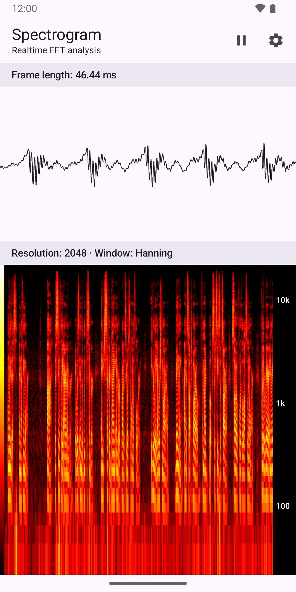
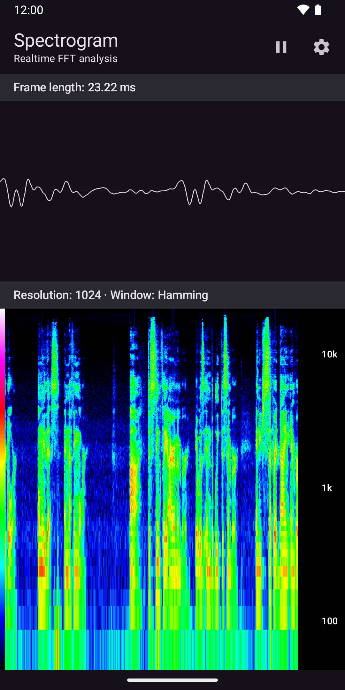
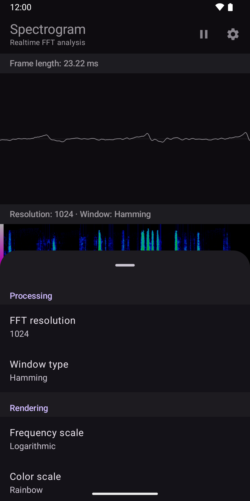

## Synopsis

[Spectrogram-Android] is a mobile application available on the Google Play store.   
It was initially developed as a basic tool to study outdoor sound properties.  
It is and will remain free to use and ad-free.

##### Key features  

  - Realtime waveform and scrolling spectrogram of the surrounding sound
  - FFT size from 32 to 65536
  - Nine window functions
  - Linear or logarithmic frequency scale, four color palettes
  - Light/dark theme (follows the system), portrait and landscape
  - Sound is analysed on the device only: nothing is recorded or sent ([privacy policy](docs/privacy-policy.html))

##### Snapshots

  

*Version 2.0, analysing a LibriVox reading of Poe's "The Raven" (public domain). Store listing texts and images are in `fastlane/metadata/android/`.*


## Build and run

Version 2 is written in Kotlin with Jetpack Compose, with no native code. To set up a Mac with
the Android SDK, the `android` command-line tool and an emulator, follow
[docs/dev-setup.md](docs/dev-setup.md). Then:

```sh
./gradlew assembleDebug
android emulator start medium_phone
android run app
```

Tests and other commands are listed in [CLAUDE.md](CLAUDE.md); releasing to Google Play is
described in [docs/release.md](docs/release.md). Version 1 (Java with a C/JNI FFT engine) is in
the git history.


## Development
Have killer features in mind you want to implement?  
You are very welcome to contribute to the project!  

## Todo
  - Add extra languages
  - Add frequency range filter
  - Add ability to play sound from the spectrogram
  - Add high resolution spectrogram export feature

## License
[zlib]

[zlib]: <https://en.wikipedia.org/wiki/Zlib_License>
[Spectrogram-Android]: <https://play.google.com/store/apps/details?id=net.galmiza.android.spectrogram>